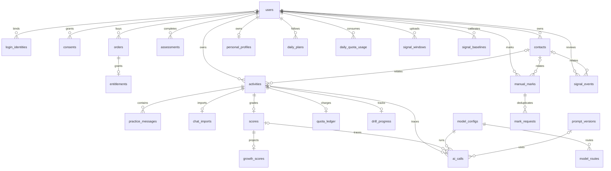

# PostgreSQL 模型 · T02

真实结构以 `server/migrations/` 为准。所有用户数据从认证得到的 `users.id` 向下查；**知道源 ID 不等于有权读取或恢复源数据**。没有音频、逐秒读数、转写或对象存储表。

## 表清单与生命周期

除注明外，个人数据均支持按所属账号导出、注销清除；表中的父键使用 `ON DELETE CASCADE`。`*_enc` 必须用 AES-GCM 加密后写入（T04），包括用户日记、画像、密钥；SQL 的 `bytea` 本身不提供加密。明文只保留检索/关联所需的随机键、运营枚举、索引时间和计量字段。摘要检索用独立密钥的 HMAC，不搜索随机密文。原始细节见[数据清单](standards/privacy.md)。

| 表 | 用途、敏感载荷 | 保留、导出和删除路径 |
| --- | --- | --- |
| `users` | 唯一内部身份、注册年龄确认、IANA 时区、冻结请求时间与稳定的 Apple 购买 token | 自己可见业务字段；冻结 15 天后按根删除。随机 `purge_id` 仅恢复清理用，不作登录 ID 或导出。 |
| `login_identities` | 手机/Apple/微信；归一化标识加密，按 `(provider,subject_hmac)` 唯一绑定 | 随用户删除，仅导出本人的可读绑定，不导出 HMAC。 |
| `consents` | 逐用途授权版本与授予/撤回时间，保留历史 | 至注销；撤回更新原行，新授权另开一行。 |
| `orders` | 支付渠道、商品、分、状态、带密钥的交易指纹 | 在归属明确时导出本人的订单；注销后 `user_id=NULL`，不保留账号 token、收据原文或手机号。 |
| `entitlements` | 已验证订单的权益区间 | 只对订单所属用户生效；到期不等于删除订单，注销清除权益。 |
| `assessments` | WLEIS 版本、16 题答卷与未取整四维/总分分别加密 | 至注销或用户删除该测评；按用户和完成时间取最新，不从展示分反算。 |
| `contacts` / `personal_profiles` | 关系人（昵称、关系、场景、人格/冲突/依恋及把握度）及本人画像，均加密 | 至删除或注销；关系人删除按 `(user_id,contact_id)` 清关联源及副本。本人画像不得复制关系人原话。 |
| `activities` | 对练、单项、回复、复盘根；`id` 即会话 ID 或请求 ID；复盘日记/已审核结果放 `content_enc`，不留导入聊天原文 | 用户历史按账号和类型取；随账号/关系人级联，可单条删除。重复 ID 只读同账号同类型原操作。另有服务端不可复用的 `source_id`。 |
| `practice_messages` | 用户消息与**已完整审核并保存**的 AI 回复，加密，按 `seq` 恢复；每个客户端消息最多一条用户发言和一条回复 | 源会话删除即删；导出含双方发言。SSE 临时片段不是历史记录。 |
| `chat_imports` | 粘贴聊天原文，独立密文，便于在不删幂等结果时擦除输入 | 按 `received_at` 在 24h 内删或随源提前删；只导出尚未到期且属本人的输入。 |
| `quota_ledger` | 每次成功扣次一行；原时区自然日与退款时间，对练/回复/复盘按源类别分账 | 可导出本人结算，随源删除；已收取的当日额度不因用户删除内容而自动退款。 |
| `daily_quota_usage` | 每用户/功能/自然日的净扣次，仅数值，不含源 ID，用于 Redis 重建 | 只保留结算与重试所需日汇总，随用户导出/删除；与扣次/退款流水在同一事务变更。 |
| `scores` | `id=activities.source_id`，同一源最多一份；理由、引文、轮次、改写与分项只在 `detail_enc`；`occurred_at` 是原发生时间 | 随活动级联，可按源导出；重投事件不得刷新时间。评分失败不构造成功评分。 |
| `growth_scores` | T26 数值投影：仅 NVC 数值与三项情绪等级密文。按 `score_id` 找到日期和账号，不另存原话或理由 | 只允许整场和复盘；随评分删除/导出。按近 30 天有效源重算，不持久化无法追溯的综合分。 |
| `drill_progress` | 单项目标、加密进度与下次重练时间 | 随单项活动删除/导出；不能作为 T26 算分输入。 |
| `daily_plans` | 每人每日一份加密训练安排、完成时间 | 随用户导出/删除；仅保存任务安排，不复制评分明细或关系人内容。公共题库由 T26 放 `content/`。 |
| `manual_marks` | 免费标记，密文含标记时间/可空场景；可空关系人外键；服务器受理时间仅用于去重、排序和清理 | 独立导出时间、对象及场景。180 天滚动或用户/关系人删除。无需心率或录音。 |
| `mark_requests` | 对每次点击请求（含窗口内复用）记下返回的标记 ID | 随标记级联；技术幂等映射不含新标记内容，导出不重复列标记。 |
| `signal_windows` | 每账号/渠道/UTC 30 秒窗口唯一；密文只含许可的均值、最大值、样本数、人声有效秒数及运动标志 | 180 天滚动或用户删除；只导出聚合，不接收原始点列或音频。 |
| `signal_baselines` | 每信号独立的密文参数、有效时长/读数、就绪原因与阈值 | 只由仍在 180 天窗口内的统计生成；过期、纠错、删除须重算或清空，不能仅按最后更新时间延期。 |
| `signal_events` | 密文保存事件来源、实际时间、本人核对或对话节奏标注；索引时间用于排序与到期清理 | 180 天滚动或账号/事件/关系人删除；导出不包含原始曲线。 |
| `model_configs` | 模型端点、AES-GCM 密钥、准入材料引用，默认停用 | 平台配置，不随个人导出；轮换后废弃密钥。T09 在启用/切换/连通测试前校验当前端点和准入材料。 |
| `model_routes` / `prompt_versions` | 七类任务的主备及灰度比例；版本化系统模板，禁放真实用户样本 | 平台配置，不随个人导出或删除；模板版本被引用时不可删除。 |
| `ai_calls` | 一次主/备尝试一行，仅关联键、结果、耗时、token、成本。评分分布通过源分数计算，不复制理由 | 随所关联的账号/活动/评分删除；导出本人调用统计，不导出密钥或模板。非个人的系统调用才可无个人关联。 |

## 写入与清理协议（后续服务必须实现）

1. **手动标记**：T32A 锁定用户行，先查 `(user_id,request_id)`；旧请求始终返回原标记，新请求才按服务端受理时间查上一条。在同一事务为新请求写返回 ID 映射。距上次新建 `<60s` 返回原记录，不更新其时间；`>=60s` 新建。数据库在 UTC 时间轴用半开区间排斥约束兜住并发；不按分钟截断，不跨用户去重。
2. **幂等/退款**：T06/T19 对同一活动加锁；首条完整回复落库和记账必须同事务。退款只更新 `refunded_at IS NULL` 的原行，并据 `charged_day` 调整 Redis 对应的日额度，而不是退款当日。Redis 预占/确认/重建及内容删除后的当日已用计数由 T06 验收。
3. **删除防重放**：T04 负责独立、持久、不可驱逐的删除登记存储，键 `deleted:<opaque_source_id>`、空值，**仅用存储 TTL** 表达期限，不存用户 ID、时间线、正文或分数。TTL 从删除起不短于 `max(30天, 最长可恢复备份期)`；扩展备份保留期前先扩展覆盖，不能用普通可逐出的缓存。账号使用 `purge_id`；活动使用 `source_id`，含尚未评分的活动；其他独立删除的源使用其不透明随机键。登记不随业务库备份回退，不向用户导出。
4. **并发与恢复**：删除和消费按相同顺序锁账号与源；注销先枚举所有源。持久登记成功才提交级联删除；中断后按登记继续删除，不将登记和业务库双写假定为跨库事务。T04 须让未完成清理的源立即不可读、不可导出或消费，登记不可用则停止相关操作。消费只从仍存在的账号及评分读值，拒绝过期/已删事件，绝不 upsert 源或账号。T34 恢复时隔离流量与消费者，加载完整的最新登记→重删→复核后方可开放。
5. **限期数据**：SQL 提供到期索引，不会自动执行清理。T21/T30/T32A 应同时做按期限的读过滤与定时物理清理，拒绝重新导入过期输入，T35 用同一过滤导出。手机录音的三天清理在设备端，与上述表无关。
