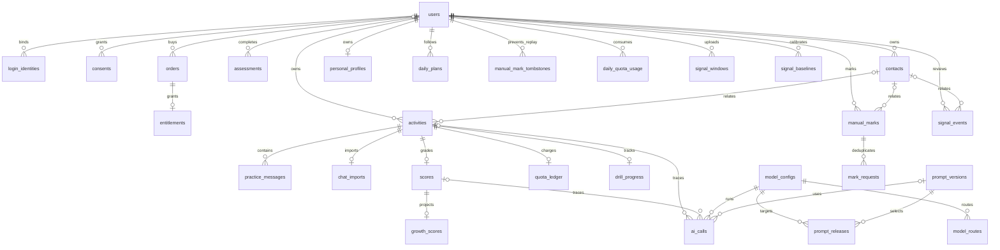

# PostgreSQL 模型 · T02

真实结构以 `server/migrations/` 为准。所有用户数据从认证得到的 `users.id` 向下查；**知道源 ID 不等于有权读取或恢复源数据**。没有音频、逐秒读数、转写或对象存储表。

## 表清单与生命周期

除注明外，个人数据均支持按所属账号导出、注销清除；表中的父键使用 `ON DELETE CASCADE`。`*_enc` 必须用 AES-GCM 加密后写入（T04），包括用户日记、画像、密钥；SQL 的 `bytea` 本身不提供加密。明文只保留检索/关联所需的随机键、运营枚举、索引时间和计量字段。摘要检索用独立密钥的 HMAC，不搜索随机密文。原始细节见[数据清单](standards/privacy.md)。

| 表 | 用途、敏感载荷 | 保留、导出和删除路径 |
| --- | --- | --- |
| `users` | 唯一内部身份、注册年龄确认、IANA 时区、冻结请求时间与稳定的 Apple 购买 token | 自己可见业务字段；冻结 15 天后按根删除。随机 `purge_id` 仅恢复清理用，不作登录 ID 或导出。 |
| `login_identities` | 手机/Apple/微信；归一化标识加密，按 `(provider,subject_hmac)` 唯一绑定 | 随用户删除，仅导出本人的可读绑定，不导出 HMAC。 |
| `auth_sessions` | 用户、随机会话 ID、随机刷新令牌的 SHA-256 和到期时间；不存访问 JWT/刷新明文 | 轮换或退出删除该会话，冻结撤销所有会话，注销级联；过期清理，不导出认证材料。 |
| `sms_challenges` | 注册前即可存在；只存与绑定相同的手机号 HMAC、发送窗口、次数、验证码 HMAC/剩余尝试 | 5 分钟可验证，成功或耗尽即清验证码摘要；限流行 24 小时后由定时任务回收，注销时随已绑定手机号同步清理；不导出。 |
| `consents` | 逐用途授权版本与授予/撤回时间，保留历史 | 至注销；撤回更新原行，新授权另开一行。 |
| `orders` | 支付渠道、商品、分、状态、带密钥的交易指纹 | 在归属明确时导出本人的订单；注销后 `user_id=NULL`，不保留账号 token、收据原文或手机号。 |
| `entitlements` | 已验证订单的权益区间 | 只对订单所属用户生效；到期不等于删除订单，注销清除权益。 |
| `payment_facts` | 每单原始支付/退款时间、苹果覆盖终点或安卓卡天数；按账号与请求 ID 幂等 | 同账号锁下重算权益；不存 JWS、回调原文或明文支付参数；`checkout_enc` 绑定账号/订单，只在五分钟内复用，入账/退款清空。注销级联删除。 |
| `payment_notices` / `apple_purchase_chains` | 通知及其事实的 HMAC；苹果原交易链指纹绑定首笔订单 | 通知随账号清除。链锚点仅引用可脱敏订单，注销后不得按恢复者重绑；不导出内部指纹。 |
| `assessments` | WLEIS 版本、16 题答卷与未取整四维/总分分别加密 | 至注销或用户删除该测评；按用户和完成时间取最新，不从展示分反算。`completion_pending` 与答卷同时提交；订阅事务成功才清位，删除源同时移除待投递状态。 |
| `contacts` / `personal_profiles` | 关系人（昵称、关系、场景、人格/冲突/依恋及把握度）及本人画像，均加密 | 至删除或注销；关系人删除按 `(user_id,contact_id)` 清关联源及副本。本人画像不得复制关系人原话。 |
| `activities` | 对练、单项、回复、复盘根；`id` 是活动 ID（回复的客户端请求键另见 `reply_requests` / `reply_request_keys`）；对练 `capped` 表示已有完整轮次、预算耗尽且仍可评分；复盘日记/已审核结果放 `content_enc`，不留导入聊天原文 | 用户历史按账号和类型取；随账号/关系人级联，可单条删除。重复 ID 只读同账号同类型原操作。另有服务端不可复用的 `source_id`。 |
| `review_requests` | T23：账号内 `request_id`、带密钥的输入/场景摘要、已审核修复话的加密检查点、最多保留 15 分钟的未审核完整生成检查点、待投递位；完整日记和带引用评分分别在 `activities.content_enc` 与 `scores.detail_enc`。 | 随活动、关系人或账号级联；标记/事件删除只置空其关联键；检查点在成功、失败、危机、过期或活动删除时清除，审核不可用且未过期才保留。`reviews.json` 每次复盘一项，不导出 HMAC 或未审核生成检查点；扣次、日志分别由所属模块导出。 |
| `review_tombstones` | T23：账号内 `request_id` 与输入 HMAC，只记录删除事实，不含正文或来源 ID；同键原内容重放返回已删除，改内容重放返回冲突。 | 删除复盘时由活动触发器写入；账号注销显式清除；不导出、不用于检索。 |
| `practice_messages` | 用户消息与**已完整审核并保存**的 AI 回复，加密，按 `seq` 恢复；每个客户端消息最多一条用户发言和一条回复 | 源会话删除即删；导出含双方发言。SSE 临时片段不是历史记录。 |
| `practice_work` | T19：每场的工作令牌、租期、客户端消息键、预算及评分交付状态；`settlement_pending`/`settlement_outcome` 持久记录危机、审核无结论或失败收尾，供维护任务重试同一事务；私密场景与关卡快照在 `activities.content_enc`。 | 随活动、关系人或账号级联。`training.json` 导出本人源键、输入、消息、评分/进度与结算，不导出内部令牌或补偿意图。 |
| `reply_requests` | T21 活跃映射：`(user_id,request_id)` 指向本人的活动；只保留输入的带密钥 HMAC，不保留聊天或目标。审核后结果在活动密文中，T06 同事务扣次。 | 随活动级联；导出请求键和结果，不导出摘要检索键。T21 迁移清理回复类 `chat_imports`，并拒绝再次写入。 |
| `reply_request_keys` | T21 删除防重放墓碑：只保留账号、请求键和输入 HMAC；`activity_id` 在活动删除时置空，不保留结果、聊天或目标。 | 活跃时与 `reply_requests` 一一对应；活动单删后墓碑保留并令原键重放返回 409，账号删除时级联清除。不导出。 |
| `reply_feedback` | 使用的建议下标、效果、可选本人确认一起加密；按活动及 HMAC 去重。`pending` 只表示待投递的明确本人画像证据（最多一条/活动），`outcome_pending` 表示普通效果的非画像交接；两队列独立扫描、独立清位。 | 仅导出本人的反馈。源、关系人或账号删除时级联；画像投递与 T25 消费同事务，普通效果只发不可复用源键和原时间，无正文事件副本。 |
| `reply_outcome_receipts` | T21 → T25 的普通效果去重回执：只保存 `feedback_id`、账号/源键、`source_kind`、原发生时间、建议下标和处理时间；不存聊天、建议或效果正文，不创建画像观察。 | 随反馈、活动、关系人或账号级联；删除后重投不得复活，账号导出不包含该内部回执。 |
| `chat_imports` | 粘贴聊天原文，独立密文，便于在不删幂等结果时擦除输入 | 按 `received_at` 在 24h 内删或随源提前删；只导出尚未到期且属本人的输入。 |
| `quota_attempts`（T06） | 每个活动一条结算状态；占位日、到期时间及工作令牌防止旧生成覆盖新尝试 | 随活动/账号级联；导出状态，不导出内部令牌。仅有效占位影响可用量，不是成功账单。 |
| `quota_ledger` | 每次成功扣次一行；原时区自然日与退款时间，对练/回复/复盘按源类别分账 | 可导出本人结算，随源删除；已收取的当日额度不因用户删除内容而自动退款。 |
| `daily_quota_usage` | 每用户/功能/自然日的净扣次，仅数值，不含源 ID，用于 Redis 重建 | 只保留结算与重试所需日汇总，随用户导出/删除；与扣次/退款流水在同一事务变更。 |
| `scores` | `id=activities.source_id`，同一源最多一份；理由、引文、轮次、改写与分项只在 `detail_enc`；`occurred_at` 是原发生时间 | 随活动级联，可按源导出；重投事件不得刷新时间。评分失败不构造成功评分。 |
| `growth_scores` | T26 数值投影：仅 NVC 数值与三项情绪等级密文。按 `score_id` 找到日期和账号，不另存原话或理由 | 只允许整场和复盘；随评分删除/导出。按近 30 天有效源重算，不持久化无法追溯的综合分。 |
| `drill_progress` | 单项目标、加密进度与下次重练时间 | 随单项活动删除/导出；不能作为 T26 算分输入。 |
| `daily_plans` | 每人每日一份加密训练安排、完成时间 | 随用户导出/删除；仅保存任务安排，不复制评分明细或关系人内容。公共题库由 T26 放 `content/`。 |
| `profile_observations` | 明确核对的方向绑定账号与源活动/事件，字段加密；同一源/主体一次。画像按现存来源重算，导出 `profiles.json`。关系人或源删除通过外键级联，不保留独立的置信度副本。聊天材料仅在请求内处理，不写库。 | 随源删除；传感器事实随事件 180 天失效。 |
| `activity_profile_context` | T25：来源活动首次被本人反馈引用时冻结的场景，AES-GCM 信封按账号/活动绑定；同一活动只保留首次场景，重投或关系人后续编辑不改变。 | 随来源活动或账号级联删除；不复制反馈原文。 |
| `profile_inference_requests` | T25：账号内 `request_id` 的 `processing/complete/invalidated` 状态，绑定关系人、开始时的 `chat_import` 与 `contacts` 授权记录和输入 SHA-256；不保存聊天原文。完成重放只返回当前画像，不再次调用模型。 | 随关系人、授权记录或账号级联；任一授权撤回/重授后旧请求不可落库。 |
| `manual_marks` | 免费标记，密文含标记时间/可空场景；可空关系人外键；服务器受理时间仅用于去重、排序和清理 | 独立导出时间、对象及场景。180 天滚动或用户/关系人删除。无需心率或录音。 |
| `mark_requests` | 对每次点击请求（含窗口内复用）记下返回的标记 ID | 随标记级联；技术幂等映射不含新标记内容，导出不重复列标记。 |
| `manual_mark_tombstones` | 删除防重放证据，仅 `(user_id, request_id)`；`user_id` 只作账号作用域，不含标记 ID、时间、对象、场景、密文或删除时间 | 删除标记前由触发器从 `mark_requests` 复制所有相关请求键；不导出，账号删除时级联清除。 |
| `signal_windows` | 每账号/渠道/UTC 30 秒窗口唯一；独立随机 `purge_id` 进入 `erasure_roots`，不向客户端或导出暴露；密文只含许可的均值、最大值、样本数、人声有效秒数及运动标志 | 180 天滚动或用户删除；只导出聚合，不接收原始点列或音频。 |
| `signal_baselines` | 每信号独立的密文参数、有效时长/读数、就绪原因与阈值 | T30 按需从仍在 180 天内的源重算，不持久化可续命的基线；过期、纠错、删除须重算或清空，不能仅按最后更新时间延期。 |
| `signal_events` | 密文保存事件来源、实际时间、本人核对或对话节奏标注；索引时间用于排序与到期清理 | 180 天滚动或账号/事件/关系人删除；导出不包含原始曲线。 |
| `model_configs` | 模型端点、AES-GCM 密钥、准入材料引用，默认停用 | 平台配置，不随个人导出；轮换后废弃密钥。T09 在启用/切换/连通测试前校验当前端点和准入材料。 |
| `provider_admissions` / `gateway_revision` | T09：按材料引用、服务商、HTTPS 基址、用途类型绑定准入；单行 UUID 版本随准入和模型配置的变更在同一事务刷新 | 平台元数据，不含个人记录，不导出。启用配置通过复合外键绑定已核准端点；撤销须先停用。Redis 只发变更提示，不承载材料、密钥或地址。见 [T09](tasks/T09.md)。 |
| `model_routes` / `prompt_versions` | 七类任务的主备及灰度比例；版本化系统模板，禁放真实用户样本 | 平台配置，不随个人导出或删除；版本只追加，草稿也不能修改或删除。 |
| `prompt_releases` | 每个任务/生成模型唯一发布指针：主版本、可空实验版本和实验占比；两组版本均须属于该任务 | 平台配置，不存个人分组或渲染结果，不随个人导出或删除。回滚原子切换指针，见 [T11](tasks/T11.md)。 |
| `ai_calls` | 一次主/备尝试一行，仅关联键、结果、耗时、token、成本。评分分布通过源分数计算，不复制理由 | 随所关联的账号/活动/评分删除；导出本人调用统计，不导出密钥或模板。非个人的系统调用才可无个人关联。 |

### T13 后台账号与审计（独立于 App 用户）

迁移 `20261121193013_admin_security` 增加 `admin_accounts`（后台账号、bcrypt 摘要及角色）、`admin_sessions`（管理员外键、随机令牌摘要、过期时间）及 `admin_audit_logs`。审计仅保存事件 UUID、时间、管理员 UUID（未认证/CLI 为全零）、动作、规范化对象及结果；按时间或管理员 + 时间倒序索引，不留密钥、登录名、请求内容或用户关联。三表均不属于 App 个人数据分区。

### T04 协调器元数据（非个人导出分区）

迁移 `20261121000500_privacy` 新增 `ledger_binding`（PG 安装与独立登记库的随机身份绑定）、`pending_erasure`（仅未完成操作的根 UUID，清理成功即移除）和 `erasure_roots` 视图（复用已有根与关系人级联关系，不另存数据）。前两者不是独立删除历史。独立 Redis 的 `deleted:<opaque_id>` 值为空、期限仅由 TTL 表示；常驻安装标识只含随机安装身份与覆盖天数，不含账号或源。启动先核对身份、持久化策略及期限，再分页比对现存根与登记重删；不能据此证明灾备所取的登记副本完整或最新，T34 须另行验证。

## 写入与清理协议（后续服务必须实现）

1. **手动标记**：T32A 锁定用户行，先查删除墓碑；命中原 request ID 时返回冲突且绝不创建。未命中才查 `(user_id,request_id)`：未删除的旧请求返回原标记，新请求按服务端受理时间查上一条，并在同一事务写返回 ID 映射。距上次新建 `<60s` 返回原记录，不更新其时间；`>=60s` 新建。数据库在 UTC 时间轴用半开区间排斥约束兜住并发；不按分钟截断，不跨用户去重。删除前仅把相关 `(user_id,request_id)` 写入墓碑，不保留个人内容；账号删除级联清除墓碑。
2. **幂等/退款**：T06/T19 对同一活动加锁；首条完整回复落库和记账必须同事务。退款只更新 `refunded_at IS NULL` 的原行，并据 `charged_day` 调整 Redis 对应的日额度，而不是退款当日。Redis 预占/确认/重建及内容删除后的当日已用计数由 T06 验收。
3. **删除防重放**：T04 负责独立、持久、不可驱逐的删除登记存储，键 `deleted:<opaque_source_id>`、空值，**仅用存储 TTL** 表达期限，不存用户 ID、时间线、正文或分数。TTL 从删除起不短于 `max(30天, 最长可恢复备份期)`；扩展备份保留期前先扩展覆盖，不能用普通可逐出的缓存。账号使用 `purge_id`；活动使用 `source_id`，含尚未评分的活动；其他独立删除的源使用其不透明随机键。登记不随业务库备份回退，不向用户导出。
4. **并发与恢复**：删除和消费按相同顺序锁账号与源；注销先枚举所有源。持久登记成功才提交级联删除；中断后按登记继续删除，不将登记和业务库双写假定为跨库事务。T04 须让未完成清理的源立即不可读、不可导出或消费，登记不可用则停止相关操作。消费只从仍存在的账号及评分读值，拒绝过期/已删事件，绝不 upsert 源或账号。T34 恢复时隔离流量与消费者，加载完整的最新登记→重删→复核后方可开放。
5. **限期数据**：SQL 提供到期索引，不会自动执行清理。回复助手原文不落库，见 T21；其他有保留期的模块应同时做按期限的读过滤与定时物理清理，拒绝重新导入过期输入，T35 用同一过滤导出。手机录音的三天清理在设备端，与上述表无关。

### T10 任务路由与调用统计

迁移 `20261121200010_task_routing` 为 `model_routes` 增加可替换的 `moderation_model`；路由变动与配置、准入变动共享 T09 的事务版本。`model_configs.input_cny_per_million` / `output_cny_per_million` 分别是每百万输入 / 输出 token 的人民币单价，NULL 未定价，0 为明确免费；不预置端点或价格。一次路由固定所选条款和价格，不把更新后的配置拼进正在执行的回复。

`ai_calls.operation_id` 关联一次业务操作，`id` 区分每次模型或审核尝试。每行按实际用量与当次单价计算成本；上游未报告完整用量时 token 和成本为 NULL，不伪造零。仅生成尝试关联业务提示词版本；审核调用用各自的模型 ID。评分成功保存后在源事务中补 `score_id`，不复制理由、引文或明细。`ai_calls.json` 是账号导出分区；已有账号、活动、关系人和评分外键在源删除事务中级联清理。

### T14 · 模型运维元数据

`20261121211514_model_key_suffix` 新增 `model_configs.key_last_four`。仅在写入新密钥时登记显示后缀；历史行默认空串，不解密回填。模型密文、价格、审核用途与准入材料不属于账号数据。撤销准入在一个事务内移除受影响的任务路由、停用并解绑模型、删除凭据，审计成功后才提交；不删除模型 ID 及历史调用统计。
